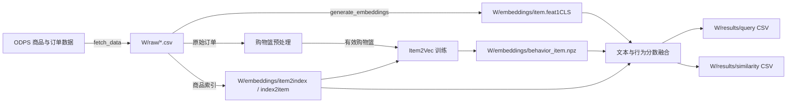

# Item2Vec 文本与行为融合召回

本项目使用 M3E/BERT 生成商品文本向量，使用 Item2Vec 学习订单购物篮行为。共购召回使用 `complement`：有行为使用自身向量，无行为尝试同品类商品的行为迁移，参考不足时回退文本，并通过 `recall_source` 标明来源。`similar` 和 `hybrid` 融合文本与行为余弦相似度。所有流程通过 `scripts/` 下的 Bash 脚本执行，Python 实现位于 `src/item2vec/`。

## 共购召回快速开始

已有配套的 `<work-dir>/raw/` 订单与商品文件，以及 `<work-dir>/embeddings/` 文本向量与索引时，执行：

```bash
WORK_DIR=/ml/output/output
bash scripts/preprocess_baskets.sh 30 5 --work-dir "$WORK_DIR"
bash scripts/train.sh 256 30 15 10 --work-dir "$WORK_DIR"
bash scripts/export_similarities.sh 50 512 complement 0 --work-dir "$WORK_DIR"
bash scripts/query_similar.sh ITEM_ID 50 complement 0 --work-dir "$WORK_DIR"
```

升级旧项目时须先新增预处理阶段，再重新训练以生成上下文向量和候选偏置。冷启动迁移需保留 `raw/item.csv`；接收结果的程序需兼容新增的 `recall_source` 列。分数为候选排名分数，不是购买概率，迁移与文本回退结果也不代表该商品已经发生的共购。

## 项目结构

```text
scripts/fetch_data.sh              从 CSV、ODPS 表或 SQL 文件准备商品与订单数据
scripts/generate_embeddings.sh     生成商品文本向量和商品索引
scripts/preprocess_baskets.sh      清洗购物篮并发布训练集
scripts/train.sh                   训练 Item2Vec 行为向量
scripts/query_similar.sh           查询单个商品的相似商品
scripts/export_similarities.sh     批量导出所有商品的相似结果
scripts/evaluate_item2vec.py       按时间切分订单并离线评估共购召回
scripts/run_pipeline.sh            依次执行取数、文本向量生成、购物篮处理和行为训练
src/item2vec/data_fetch.py         数据源读取、字段标准化与 CSV 发布
src/item2vec/embedding.py          M3E/BERT 文本向量生成
src/item2vec/preprocessing.py      购物篮清洗与训练集校验
src/item2vec/training.py           Item2Vec 训练
src/item2vec/inference.py          文本和行为分数融合与结果导出
src/item2vec/scoring.py            从训练向量预计算候选偏置
src/item2vec/cold_start.py         同品类参考选择与行为向量迁移
src/item2vec/evaluation.py         时间留出与共购召回指标
src/item2vec/io.py                 模型、向量和商品索引读写
dataset/raw/.env                 默认 ODPS 配置文件
dataset/m3e-base/                  默认本地预训练文本模型
outputs/raw/                       默认原始数据目录
outputs/processed/                 默认训练购物篮目录
outputs/embeddings/                默认商品索引与向量目录
outputs/results/                   默认推理结果目录
tests/                             数据、训练、推理和脚本测试
```

## 数据契约

### 商品数据

`<work-dir>/raw/item.csv` 用于建立统一商品索引并生成文本向量：

| 字段 | 含义 | 使用方式 |
| --- | --- | --- |
| `prod_id` | 商品 ID | 去重后建立 `item2index.json` 和 `index2item.json` |
| `prod_description` | 商品文本描述 | 输入 M3E/BERT 文本编码器 |

同一 `prod_id` 出现多次时保留第一条商品描述。文本向量与商品索引的行顺序必须一致。

### 订单行为数据

`<work-dir>/raw/order_item.csv` 用于构建训练购物篮：

| 字段 | 含义 | 使用方式 |
| --- | --- | --- |
| `order_id` | 订单 ID | 定义一个训练购物篮的边界 |
| `user_id` | 用户 ID | 由取数结果保留，当前训练不直接使用 |
| `prod_id` | 商品 ID | 映射到统一商品索引 |
| `dt` | 订单日期 | 作为必填数据字段进行校验 |

预处理会按完整订单分组、对商品去重、排除商品目录外的记录。保留 `--min-basket-size` 至 `MAX_BASKET_SIZE` 个不同商品的订单（默认2至30件），再移除在有效购物篮中出现少于 `MIN_ORDER_COUNT` 单的商品；过滤后商品数低于最小篮大小的篮不进入训练。所有订单仍计入推理使用的商品总订单数。同细分类购物篮保留，由 Item2Vec 学习行为关系。

## 环境与目录

项目要求 Python 3.9 或更高版本。建议在虚拟环境中安装依赖：

```bash
python -m pip install -r requirements.txt
```

将 M3E-base 模型放入 `dataset/m3e-base/`，并从模板创建 ODPS 配置文件：

```bash
cp dataset/raw/.env.example dataset/raw/.env
```

`dataset/raw/.env` 使用以下配置：

```dotenv
ALI_ACCESS_ID=your_access_id
ALI_SECRET_ACCESS_KEY=your_secret_access_key
ALI_PROJECT=your_project
ALI_ENDPOINT=https://your-maxcompute-endpoint/api
```

ODPS 模式下前三项必填。`ALI_ENDPOINT` 可选，省略时使用代码中的杭州 VPC 默认地址。纯 CSV 模式无需凭据文件。也支持小写配置 `access_id,access_key,project,endpoint`，非空大写配置优先。凭据、原始 CSV、模型文件和下游产物均为本地运行资产，不应提交到版本库。

所有阶段使用同一个 `--work-dir` 作为产物根目录。省略时默认使用项目内的 `outputs/`：

```text
<work-dir>/
├── raw/
│   ├── item.csv
│   └── order_item.csv
├── processed/
│   ├── baskets.jsonl
│   ├── support.npz
│   └── manifest.json
├── embeddings/
│   ├── item2index.json
│   ├── index2item.json
│   ├── item.feat1CLS
│   └── behavior_item.npz
└── results/
    ├── query_<ITEM_ID>.csv
    └── item_similarity_<mode>.csv
```

ODPS 配置和文本模型属于外部输入，不写入工作目录。可分别通过 `--env-file` 和 `--model-dir` 指向本地目录、共享存储或挂载目录。

## 完整流程

执行完整训练流水线，商品和订单分别选择一个输入源：

```bash
WORK_DIR=/path/to/output
bash scripts/run_pipeline.sh --item-input-csv /path/to/items.csv \
  --order-input-csv /path/to/orders.csv --work-dir "$WORK_DIR"
```

如果 ODPS 配置和文本模型也使用挂载目录：

```bash
bash scripts/run_pipeline.sh \
  --item-input-query-file /path/to/items.sql \
  --order-input-query-file /path/to/orders.sql \
  --work-dir "$WORK_DIR" \
  --env-file /path/to/mounted/.env \
  --model-dir /path/to/mounted/m3e-base
```

执行顺序固定为：`fetch_data → generate_embeddings → preprocess_baskets → train`。任一阶段失败，脚本会立即停止。完整流水线训练完成后结束，不自动执行相似度查询或批量导出。

训练完成后批量导出每个商品的 Top-20 相似商品：

```bash
bash scripts/export_similarities.sh 20 512 complement 0 --work-dir "$WORK_DIR"
```

查询单个商品：

```bash
bash scripts/query_similar.sh ITEM_ID 10 complement 0 --work-dir "$WORK_DIR"
```

### 使用 nohup 后台执行

耗时较长时可以用 `nohup` 包装完整流水线或任一阶段：

```bash
mkdir -p "$WORK_DIR/logs"
nohup bash scripts/run_pipeline.sh --item-input-table your_catalog_table \
  --order-input-query-file /path/to/orders.sql --work-dir "$WORK_DIR" \
  > "$WORK_DIR/logs/pipeline.out" 2>&1 &
echo $!
```

重新连接后执行 `tail -f "$WORK_DIR/logs/pipeline.out"` 查看日志。`nohup` 只能避免进程因 SSH 会话断开而退出，不能防止机器重启、任务超时、OOM 或节点故障。不要同时对同一目录执行相同阶段，否则可能并发写入同名文件。

## 数据流与输出



图中 `W` 表示 `--work-dir`。`behavior_item.npz` 包含行为向量 `vectors`、上下文向量 `context_vectors`、预计算候选偏置 `candidate_bias`、商品 ID `item_ids`、商品总订单数 `order_counts` 和训练配置 `metadata`。文件写入后会先验证内容，再通过原子替换发布。没有有效行为信号的商品使用零向量；`similar` 和 `hybrid` 可回退到文本相似度，`complement` 按自身行为、迁移行为、文本回退的顺序选择路径。旧产物缺少上下文向量时，`complement` 仍使用输入向量余弦；缺少候选偏置时使用未经校正的上下文内积。

查询与批量导出的 CSV 使用相同字段：

| 字段 | 含义 |
| --- | --- |
| `master_prod_id` | 当前查询或主商品 ID |
| `slave_prod_id` | 召回的相似商品 ID |
| `similarity` | `similar/hybrid` 为融合余弦；`complement` 为候选百分位排名分数 |
| `recall_source` | 仅 `complement` 输出：`behavior` 自身行为、`behavior_transfer` 迁移行为、`text_fallback` 文本回退 |

## 各阶段 Bash 命令与参数

所有命令均从项目根目录执行：

```bash
PROJECT_DIR=/path/to/item2Vec
WORK_DIR=/path/to/output

cd "$PROJECT_DIR"
```

### 公共目录参数

| 参数 | 默认值 | 说明 |
| --- | --- | --- |
| `--work-dir DIR` | 项目内 `outputs/` | 全流程共享的产物根目录；独立运行各阶段时必须传入同一路径。 |
| `--env-file FILE` | `dataset/raw/.env` | 仅 `fetch_data.sh` 和 `run_pipeline.sh` 支持。 |
| `--model-dir DIR` | `dataset/m3e-base/` | 仅 `generate_embeddings.sh` 和 `run_pipeline.sh` 支持。 |

选项可以放在位置参数之前或之后。未知选项、重复选项或缺少选项值会直接报错。

### 1. fetch_data：准备商品与订单 CSV

#### 执行命令

```bash
# 纯 CSV：不读取 .env 或连接 ODPS
bash scripts/fetch_data.sh --item-input-csv /path/to/items.csv \
  --order-input-csv /path/to/orders.csv --work-dir "$WORK_DIR"

# ODPS 表：读取全部行
bash scripts/fetch_data.sh --item-input-table your_catalog_table \
  --order-input-table your_order_table --env-file /path/to/.env --work-dir "$WORK_DIR"

# SQL 文件：自行控制日期窗口、商品池和列别名
bash scripts/fetch_data.sh --item-input-query-file /path/to/items.sql \
  --order-input-query-file /path/to/orders.sql --env-file /path/to/.env --work-dir "$WORK_DIR"
```

#### 配置与输出

| 配置 | 是否必填 | 默认值 | 说明 |
| --- | --- | --- | --- |
| `ALI_ACCESS_ID` | 是 | 无 | ODPS Access ID |
| `ALI_SECRET_ACCESS_KEY` | 是 | 无 | ODPS Access Key |
| `ALI_PROJECT` | 是 | 无 | ODPS Project |
| `ALI_ENDPOINT` | 否 | 杭州 VPC Endpoint | ODPS 服务地址 |

参考 Unisrec_1，商品和订单分别从 CSV、ODPS 表、SQL 文件中三选一，两路可以混用。无参数时会报错，不再执行固定表或自动限制近30天。完整流水线也接受以下六个参数，仅传给取数阶段。

| 数据 | 三选一的来源参数 | 输入字段 | 输出 |
| --- | --- | --- | --- |
| 商品 | `--item-input-csv` / `--item-input-table` / `--item-input-query-file` | `prod_id,prod_description` | `<work-dir>/raw/item.csv` |
| 订单 | `--order-input-csv` / `--order-input-table` / `--order-input-query-file` | `order_id,prod_id,dt`；可带 `user_id` | `<work-dir>/raw/order_item.csv` |

允许额外列和任意列顺序，输出统一字段顺序并移除额外列。CSV 编码按字符串读取，保留前导零。`dt` 应为 `YYYYMMDD`，日期由后续预处理校验。订单必须有真实 `order_id`；Unisrec_1 的用户交互五字段不能直接替代购物篮订单。两份来源均通过字段和非空校验后，才逐个原子替换目标 CSV；校验失败保留旧文件。

ODPS 模式默认读取 `dataset/raw/.env`，可用 `--env-file FILE` 覆盖。兼容小写配置 `access_id,access_key,project,endpoint`，与上表四项依次对应；非空大写配置优先。纯 CSV 模式忽略凭据文件。表输入不附加日期或商品池过滤；需要原商品池过滤时，明确在商品 SQL 中使用 `lh_rec_gds_station_base_pool_tmp` 条件。

例如近90天订单的 `orders.sql` 可写为：

```sql
SELECT order_id, user_id, prod_id, dt
FROM unisrec_raw_data
WHERE dt >= to_char(dateadd(getdate(), -89, 'dd'), 'yyyymmdd');
```

SQL 文件按原文执行。需要全量时使用表输入或移除日期条件。已有配套 `raw/` 文件时，可跳过取数，从预处理继续执行。

### 2. generate_embeddings：生成商品文本向量

#### 执行命令

```bash
bash scripts/generate_embeddings.sh --work-dir "$WORK_DIR"
```

#### 前置文件与输出

| 类型 | 路径 | 说明 |
| --- | --- | --- |
| 输入 | `<work-dir>/raw/item.csv` | 必须包含 `prod_id,prod_description` |
| 输入 | `dataset/m3e-base/` | 本地 M3E/BERT 模型目录 |
| 输出 | `<work-dir>/embeddings/item2index.json` | 商品 ID 到向量行号 |
| 输出 | `<work-dir>/embeddings/index2item.json` | 向量行号到商品 ID |
| 输出 | `<work-dir>/embeddings/item.feat1CLS` | 768 维 float32 文本向量 |

脚本自动选择 CUDA 或 CPU。文本以每批 4 条、最大 512 Token 编码，并取模型的 CLS 向量。

### 3. preprocess_baskets：生成训练购物篮

```bash
bash scripts/preprocess_baskets.sh 30 5 --work-dir "$WORK_DIR"
```

两个位置参数依次为最大篮大小和商品在有效多商品篮中的最低订单数，默认 `30`、`5`。命名参数 `--min-basket-size N` 控制最小篮大小，默认 `2`，必须为不小于2且不大于最大篮大小的整数；原有位置参数含义保持不变。

例如只保留3至30件商品的购物篮：

```bash
bash scripts/preprocess_baskets.sh 30 5 --min-basket-size 3 --work-dir "$WORK_DIR"
```

下限按去重、排除目录外商品后的商品数判断，并在移除低频商品后再次检查。`manifest.json` 的 `parameters.min_basket_size` 记录该值；`counts.small_baskets` 统计首次过滤中低于下限的篮数（包括空篮和单商品篮），`dropped_after_support` 统计移除低频商品后低于下限的篮数。训练自动读取清单中的下限并记录到行为产物元数据，无需给 `train.sh` 重复传入；旧清单没有该字段时按2处理。

完整流水线也可传 `--min-basket-size 3`，仅传给购物篮预处理阶段。

处理结果写入 `<work-dir>/processed/`：`baskets.jsonl` 是有序商品索引购物篮，`support.npz` 保存有效篮支持数与全部订单数，`manifest.json` 记录过滤计数、参数和文件哈希。修改原始订单、商品索引或过滤参数后，需重新运行预处理并重新训练。

### 4. train：训练行为向量

#### 默认训练

```bash
bash scripts/train.sh --work-dir "$WORK_DIR"
```

#### 自定义训练参数

```bash
bash scripts/train.sh 128 30 15 10 --work-dir "$WORK_DIR"
```

四个位置参数必须同时提供：

| 位置 | 参数 | 默认值 | 说明 |
| --- | --- | --- | --- |
| 1 | `VECTOR_SIZE` | `128` | 行为向量维度，必须为正整数 |
| 2 | `MAX_BASKET_SIZE` | `30` | 允许进入训练的最大购物篮大小 |
| 3 | `NEGATIVE` | `15` | SGNS 负采样数量 |
| 4 | `EPOCHS` | `10` | 训练轮数 |

`MIN_ORDER_COUNT` 环境变量默认为 `5`，控制商品参与行为训练所需的最小有效购物篮订单数。该值和 `MAX_BASKET_SIZE` 必须与预处理阶段一致：

```bash
MIN_ORDER_COUNT=8 bash scripts/preprocess_baskets.sh 30 8 --work-dir "$WORK_DIR"
MIN_ORDER_COUNT=8 bash scripts/train.sh --work-dir "$WORK_DIR"
```

训练只读取已校验的 `processed` 产物，使用固定的全购物篮 SGNS，并将结果写入 `<work-dir>/embeddings/behavior_item.npz`。负采样指数 `ns_exponent` 为 `0.5`，高频抽样 `sample=0`；这组设置由验证期实验选定。训练结束后分块计算候选偏置并存入同一产物。需要重新训练才能使用新的负采样设置和候选校正。

### 5. query_similar：查询单个商品

#### 执行示例

```bash
bash scripts/query_similar.sh ITEM_ID 10 hybrid 0.7 --work-dir "$WORK_DIR"
```

#### 可执行参数

```text
bash scripts/query_similar.sh ITEM_ID [TOPK [RECALL_MODE [TEXT_WEIGHT]]] [--work-dir DIR]
```

| 位置 | 参数 | 是否必填 | 默认值 | 说明 |
| --- | --- | --- | --- | --- |
| 1 | `ITEM_ID` | 是 | 无 | 要查询的商品 ID |
| 2 | `TOPK` | 否 | `10` | 返回的相似商品数量 |
| 3 | `RECALL_MODE` | 否 | `hybrid` | `similar`、`complement` 或 `hybrid` |
| 4 | `TEXT_WEIGHT` | 否 | 模式默认值 | 文本基础权重，范围为 0 至 1 |

结果写入 `<work-dir>/results/query_<ITEM_ID>.csv`。文件名中的不安全字符会替换为下划线。

### 6. export_similarities：批量导出相似商品

#### 执行示例

```bash
bash scripts/export_similarities.sh 50 512 complement 0 --work-dir "$WORK_DIR"
```

#### 可执行参数

```text
bash scripts/export_similarities.sh [TOPK [BLOCK_SIZE [RECALL_MODE [TEXT_WEIGHT]]]] [--work-dir DIR]
```

| 位置 | 参数 | 是否必填 | 默认值 | 说明 |
| --- | --- | --- | --- | --- |
| 1 | `TOPK` | 否 | `10` | 每个商品导出的相似商品数量 |
| 2 | `BLOCK_SIZE` | 否 | `512` | 每批计算的主商品数量 |
| 3 | `RECALL_MODE` | 否 | `hybrid` | `similar`、`complement` 或 `hybrid` |
| 4 | `TEXT_WEIGHT` | 否 | 模式默认值 | 文本权重，范围为 0 至 1；`complement` 中用于百分位排名融合 |

结果写入 `<work-dir>/results/item_similarity_<mode>.csv`。`BLOCK_SIZE` 只控制分块计算规模，不改变相似度结果。`complement` 对无行为主商品依次尝试行为迁移和文本回退；无行为且文本向量为零时仍无结果，自身行为与迁移路径也可能因有效候选不足而少于 `TOPK` 条。

### 推理模式、权重与订单置信度

三种召回模式提供不同的基础权重：

| 模式 | 文本基础权重 | 行为基础权重 | 用途 |
| --- | ---: | ---: | --- |
| `similar` | `0.85` | `0.15` | 更重视文本语义相似 |
| `complement` | `0` | `1` | 优先挖掘 Item2Vec 学到的共购关系 |
| `hybrid` | `0.60` | `0.40` | 平衡文本和行为，默认模式 |

位置参数 `TEXT_WEIGHT` 或同名环境变量会覆盖模式的文本权重。`similar` 和 `hybrid` 使用以下订单置信度公式。`complement` 的自身行为与迁移行为路径从有行为向量的商品中选候选；文本回退路径可选全部目录商品。它不使用 `FULL_CONFIDENCE_ORDERS`，也不要求商品对在训练期直接同单。

`complement` 对没有自身行为向量的主商品，先从同细分类、有行为向量的商品中选文本余弦至少为 `0.8` 的最多5个参考商品，至少需要2个。以温度 `0.1` 的 softmax 权重平均其输入行为向量，再使用既有上下文内积和候选偏置打分。细分类从 `<work-dir>/raw/item.csv` 描述中 `商品品牌为` 前的内容取得；类别文件缺失、类别未知或参考不足时回退到文本相似度。零文本向量且无行为的商品仍返回空结果。迁移向量只用于本次推理，不写回训练产物。

调用方需兼容 `complement` CSV 新增的 `recall_source` 列，并区分推断的共购与实际行为学习结果。旧行为产物可直接用于这条回退链，无需为接入回退链重新训练。单品查询与批量导出使用相同路径。

每个商品的行为置信度为：

```text
商品置信度 = min(商品订单数 / FULL_CONFIDENCE_ORDERS, 1)
```

商品对取两件商品中较低的置信度，最终权重为：

```text
实际行为权重 = (1 - TEXT_WEIGHT) × 商品对置信度
实际文本权重 = 1 - 实际行为权重
最终相似度 = 实际文本权重 × 文本相似度 + 实际行为权重 × 行为相似度
```

例如在 `hybrid` 模式下，文本基础权重设为 `0`，满置信订单数为 `50`。商品 A 有 10 单，商品 B 有 80 单，则商品对置信度为 `0.2`，最终仍使用 `0.8` 的文本权重和 `0.2` 的行为权重。只有两件商品都达到 50 单时，才完全使用行为相似度。任一商品缺少有效行为向量时，该商品对完全回退到文本相似度。

`complement` 在有行为向量的候选中，先对输入商品向量与候选上下文向量的内积作校正，再转换为百分位排名。候选偏置为该候选与全部有效输入向量的最高 10 个内积的均值乘以 `0.4`（不足 10 个时取全部）；每个商品对分数减去候选偏置，以缓解少数候选普遍占据前列的问题。偏置完全来自训练向量，已在训练阶段预计算。提供非零 `TEXT_WEIGHT` 时再融合文本余弦百分位排名，默认文本权重为 `0`。输出 `similarity` 是融合排名分数，不是余弦值；旧版结果的绝对分数阈值不能直接沿用。直接同单次数只用于离线评估，不参与排序。

推理相关环境变量如下：

| 环境变量 | 默认值 | 说明 |
| --- | --- | --- |
| `RECALL_MODE` | `hybrid` | 未提供对应位置参数时使用 |
| `TEXT_WEIGHT` | 模式默认值 | 未提供对应位置参数时使用 |
| `FULL_CONFIDENCE_ORDERS` | `50` | `similar`、`hybrid` 中行为信号达到满置信所需的订单数；`complement` 忽略 |

环境变量可以与位置参数组合使用：

```bash
RECALL_MODE=similar \
FULL_CONFIDENCE_ORDERS=80 \
  bash scripts/export_similarities.sh 20 512 --work-dir "$WORK_DIR"
```

位置参数的优先级高于同名环境变量。

### 离线评估 Item2Vec 共购召回

```bash
python scripts/evaluate_item2vec.py split /path/to/order_item.csv \
  --train /tmp/item2vec_train.csv \
  --validation /tmp/item2vec_validation.csv \
  --test /tmp/item2vec_test.csv

python scripts/evaluate_item2vec.py evaluate /tmp/item2vec_test.csv \
  /path/to/baseline.csv /path/to/candidate.csv --top-k 50 \
  --item-csv /path/to/item.csv
```

默认使用最后 14 天测试、此前 14 天验证，其余订单训练；可用 `--test-days`、`--validation-days` 调整。先分别用**同一训练期**训练基线和候选模型并导出结果，再用上述 `evaluate` 命令比较 `Recall@50`、按留出同单次数加权的 `Recall@50`、`NDCG@50` 和商品覆盖率。提供 `--item-csv` 后还会输出同细分类与跨细分类加权召回；未知类别商品对从这两项分母中排除。不能直接用包含测试期订单的全量模型结果作基线。

本次购物篮处理、上下文向量实验和鸡蛋/豆腐案例见 [`docs/2026-10-29-item2vec-co-basket-results.md`](docs/2026-10-29-item2vec-co-basket-results.md)。

冷启动方案、按商品留出方法与结果见 [`docs/2026-10-29-cold-start-results.md`](docs/2026-10-29-cold-start-results.md)。以下为一次时间留出结果，需在后续时间窗口复核：

| 对照 | 指标 | 基线 | 优化后 |
| --- | --- | ---: | ---: |
| 已有行为商品：输入余弦 → 上下文打分、负采样与候选校正 | 跨细分类加权 Recall@50 | 4.064% | 9.080% |
| 已有行为商品：上一版上下文 → 本轮训练与打分优化 | 前100候选占比 | 60.62% | 56.32% |
| 100个按商品留出的冷启动商品：文本 → 行为迁移 | 整体加权 Recall@50 | 10.46% | 15.87% |

## 验证与本地产物

```bash
PYTHONPATH=src python -m pytest -q
bash -n scripts/*.sh
```

`outputs/`、原始CSV、模型和凭据均不提交到Git。实验对照模型、临时导出和缓存可在实验结束后清理；应保留生产工作目录的 `raw/`、`processed/`、`embeddings/` 和最终 `results/`，以及验证报告。报告中的历史实验路径可能已随中间文件清理而删除。
